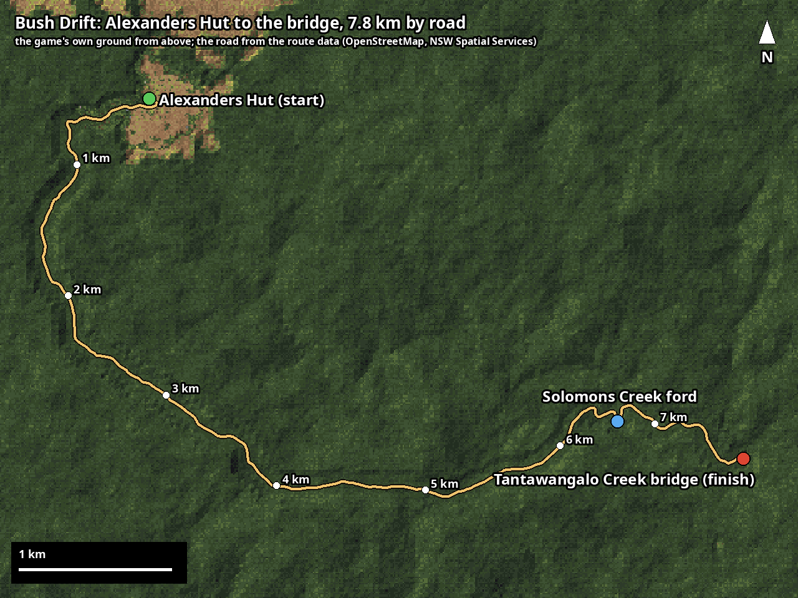

# Bush Drift

A small drifting game on a real dirt road: 7.8 km from Alexanders Hut in the South East Forest National Park
(NSW) down Robinsons Track and Cattlemens Track to the Tantawangalo Creek bridge, in a LandCruiser 79 ute.
Gravel, ditches, tall wet forest either side, real hills from the NSW elevation model, and a pixel-art look.
Hit a tree or a post and the run is over. Or pick Explore on the title and roam with no score.

**Play in the browser:** https://aedyle.github.io/Bush-Drift/ (a play-test build; keyboard).
**Android:** https://github.com/aedyle/Bush-Drift/releases/latest/download/bush-drift.apk (Android 10 or newer;
install steps in the [latest release](https://github.com/aedyle/Bush-Drift/releases/latest)).



## Controls

| | keyboard |
|---|---|
| steer | ← → |
| accelerate / brake | ↑ / ↓ |
| handbrake | Space |
| Low Range (Explore only) | L |
| pause menu | Esc |
| restart / handling preset / pixel size | R / H / P |
| small map while driving (on / off) | M |
| readout | F1 |

A gamepad works too in the desktop build.

## Scoring

Any slide scores: the further the tail is out and the faster you're going, the faster the pot fills (a smooth
curve from about 1 degree, so small slides score a little and big ones a lot; driving straight scores nothing).
Keep sliding and the multiplier climbs (up to ×9). There's no time-out: the pot banks when you leave the road
(two wheels in the ditch, or off into the bush), and the bridge banks it for you. Crash into a tree or a post and
the unbanked pot is lost, and the run is over. Logs don't stop you: they splinter, and each one is firewood in the
tray. The run ends at the bridge, at a tree or post, or after driving the wrong way.

Donuts: a full turn on the spot (full lock and throttle from a standstill, tail out) is worth 500 points straight
onto the score when it's on the road. The car park is for practising them (no points there).

## Drift and Explore

The title menu has two ways to play. **Drift** is the scored run to the bridge described above. Leaving the road is
allowed there: it says OFF-ROAD (nothing scores out there) and counts down from 15 seconds, then puts you back on
the track. A bank and thick scrub mark the edge of the bush you can drive in; round the hut the whole clearing is
open. Checkpoints along the road make sure the bridge only counts if you drove the road.

**Explore** has no score and no clock: drive the road both ways, or off it. Trees stop you rather than ending
anything. There's firewood to split (hit logs at 15 to 35 km/h; the chainsaw blunts and is sharpened at the hut),
a full tray to bring back to the hut, and the makings of a charcuterie board hidden round the hut's clearing.
Low Range (L, or LOW on a phone) is the 79's 4WD low for steep, rough ground. Hard knocks and big landings
damage the ute; a flat is changed from the pause menu, and the hut fixes everything. The pause menu (Esc) also
has the map, back to the hut and a new day.

Twenty deer are hidden in the bush, in the same places every run; drive into one to find it. Finds are kept on the
device, with the achievements (title menu → Achievements): grouped in sections, with filters, progress bars and a
clue for each hidden one. Track up to three and they show while you drive.

Handling presets (H): safer, best (the default) and drift, which has less grip at the rear, rear-biased brakes and
more low-down torque, so a push of throttle swings the tail out.

## Building

Desktop (Linux; needs raylib 6.x and its pkg-config file):

```
make route          # fetch and build the road data into data/ (cached downloads; see scripts/README.md)
blender -b --python tools/make_plants.py -- assets-built/plants.txt
blender -b --python tools/make_hut.py -- assets-built/hut.txt
blender -b --python tools/make_world.py -- assets-built/world.txt   # the sambar deer and the edge's scrub
blender -b --python tools/make_79.py -- src-models/j79-offroad/scene.gltf assets-built/lc79.car docs/car
make bush-drift && ./bush-drift
```

The 79 model is downloaded by hand from Sketchfab (link in `docs/CREDITS.md`) into `src-models/j79-offroad/`.

**Or skip those five build steps:** `./scripts/fetch-data.sh` downloads the built road and model files from the
latest "Game data" release (the same files the apps ship; the release it uses, and its checksum, are in the
script).

Browser: `./web/build.sh` (Emscripten; see `web/README.md`). Android: `./android/build.sh` (`android/README.md`).
iPhone: on a Mac with Xcode (`ios/README.md`).

Checks: `./bush-drift --cartest` (the handling against `docs/handling-spec.md`), `--routetest`, `--drivetest`,
`--selftest` (the records and progress files, the achievements' rules, the deer's spots). `--drivetest` takes switches
for the build B tests: `BOT_SHORTCUT=beeline|cut` (+ `BOT_GHOST=1`, trunks off) tries to cut across the bush to the
bridge (`gate`: up Cattlemans Link Trail into the gate); `BOT_DEER=1` drives into every deer; `BOT_LOGS=1`, `BOT_DONUT=-1`, `BOT_NOBRAKE=2`, `BOT_AT=…`
and `BOT_KICK=…` are the other scripted drives; `BOT_EVENTS=1` prints what happens. `tools/route_map.py` draws `docs/route/birdseye.png`.

## What's in it

- `src/car.c`: the ute's handling, written from `docs/handling-spec.md`: a planar rigid body on four tyres
  with load transfer, a gravel tyre curve, a 2.8 turbo-diesel torque curve and a five-speed gearbox.
  Numbers in `tuning-car.txt`.
- `src/route.c`: the road (OpenStreetMap line refined against NSW imagery), its ground and ditches, the
  forest placed by vegetation zone, Alexanders Hut and the campground, streamed in chunks.
- `src/main.c`: window, input, chase camera, the low-resolution palette look, sun shadows, sky and haze,
  generated sound, scoring, menus and records.
- `src/world.c`: the deer, the achievements and the progress kept on the device.
- `scripts/`: the map-data pipeline. `tools/`: the Blender scripts that make the ute, the plants, the hut and
  the deer, the photo-matching tools used to place the hut, and the route map.

## Credits

See `docs/CREDITS.md`. In short: road line © OpenStreetMap contributors (ODbL); elevation and tree cover
from NSW DEM and imagery © State of NSW (Spatial Services) (CC BY 4.0; no imagery pixels are included); the ute from "Toyota Land Cruiser J79 Pickup Off- Road" by DR1KING100K
(CC BY 4.0); the song "The Late Cake" by willfarrell85; built with raylib (zlib licence). Bush Drift grew out of an earlier private drifting project;
nothing from any other game is in this repository.
